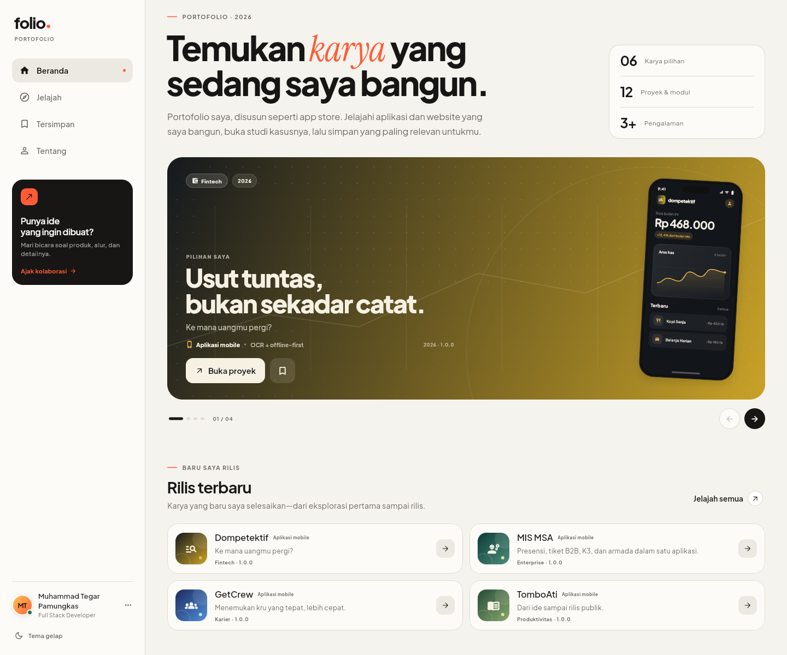
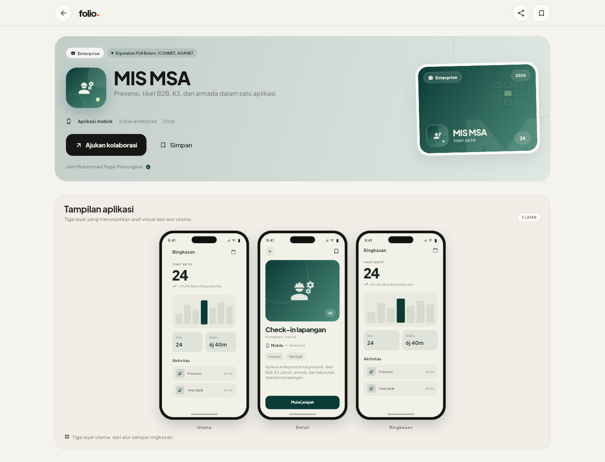
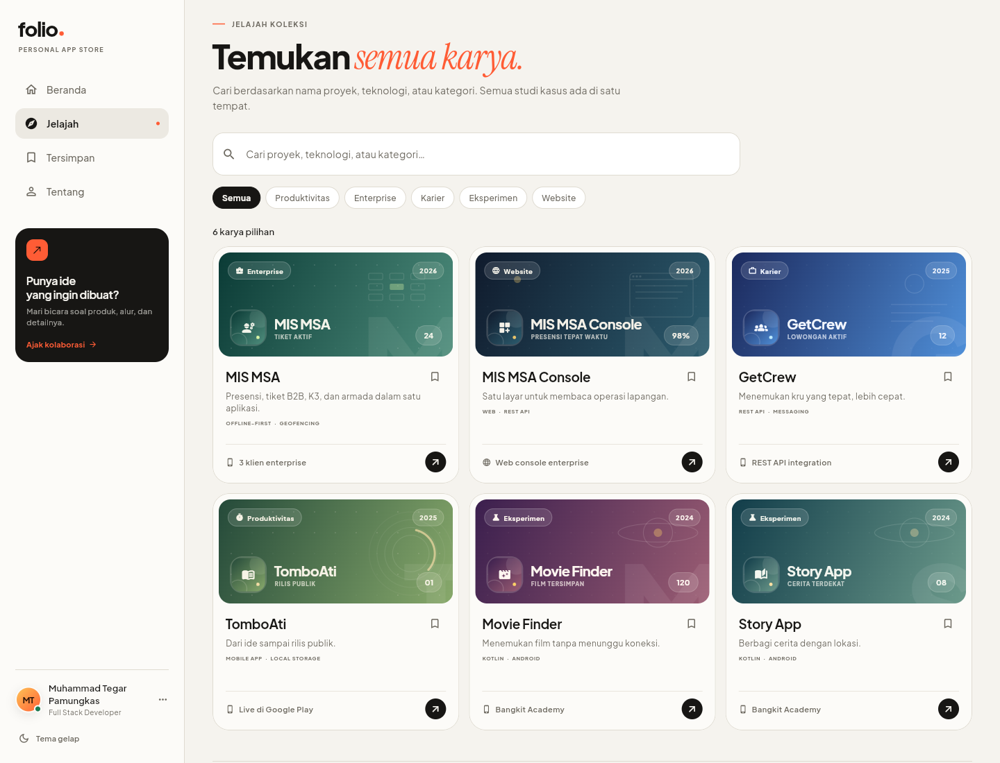
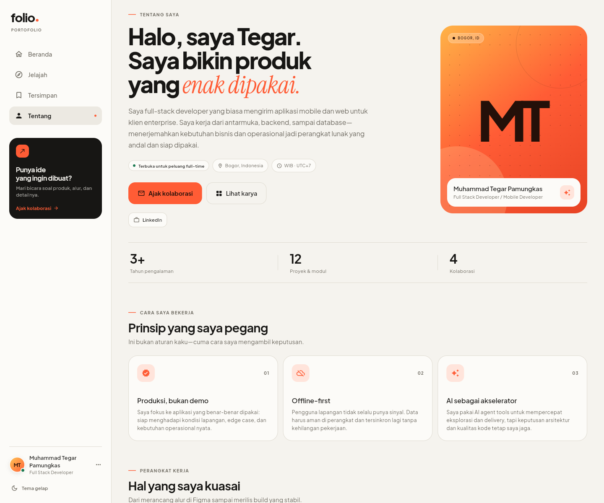
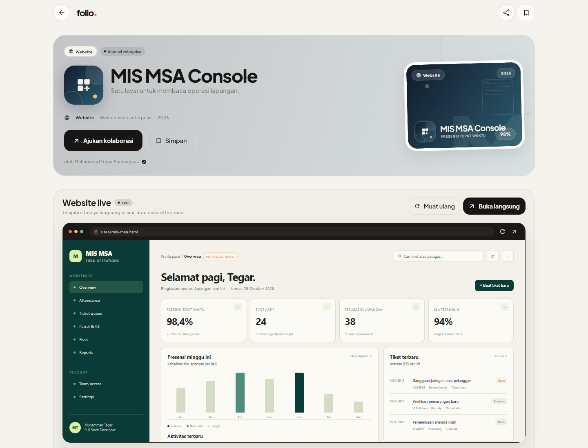
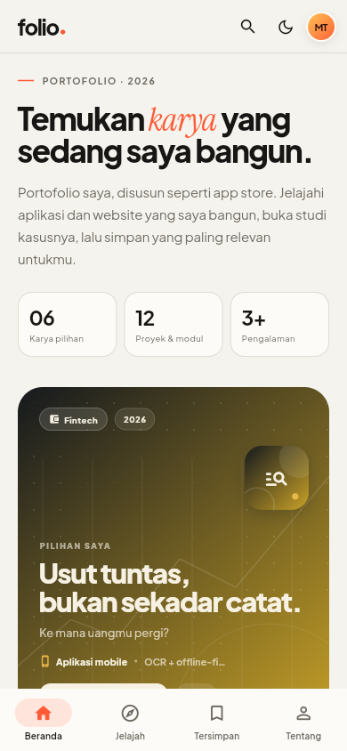
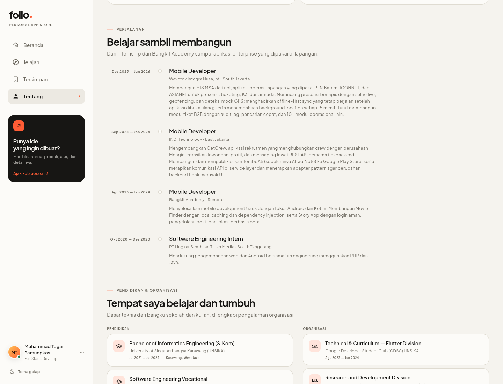
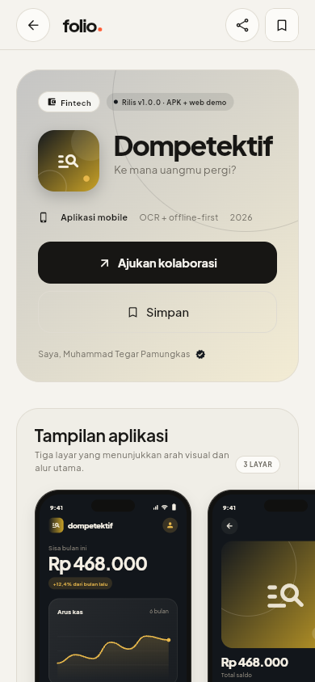

# Folio — Muhammad Tegar Pamungkas

Portofolio dalam bentuk app store milik **Muhammad Tegar Pamungkas**, Full Stack Developer / Mobile Developer. Dibangun dengan Flutter untuk menampilkan aplikasi mobile dan website sebagai katalog yang bisa dijelajahi, dicari, disimpan, dan dibuka sebagai studi kasus.

[Live site](https://mtegarpamungkas.github.io/folio/) · [GitHub repo](https://github.com/MTegarPamungkas/folio)



## ✨ Fitur

- **Storefront yang dikurasi** — hero editorial, carousel proyek pilihan, rilis terbaru, dan kategori.
- **Pencarian & filter** — cari berdasarkan nama, tagline, teknologi, atau kategori secara langsung.
- **Halaman detail bergaya app listing** — ikon, metadata proyek, pratinjau tiga layar untuk aplikasi, cerita proyek, fitur, catatan rilis, dan proyek terkait.
- **Live website preview** — proyek website bisa langsung tampil di halaman detail lewat iframe saat dibuka di web, dengan tombol **Buka langsung** ke tab baru. Di native, preview memakai artwork statis dengan opsi direct.
- **Koleksi tersimpan** — simpan proyek dengan `SharedPreferences`; data tetap ada setelah aplikasi dibuka ulang.
- **Profil pembuat** — bio, prinsip kerja, keahlian, pengalaman, pendidikan, organisasi, sosial, dan preferensi tema.
- **Kontak yang berfungsi** — email dan nomor telepon siap disalin; form membuka aplikasi email dengan subjek dan isi yang sudah terisi.
- **Responsif** — sidebar di desktop, bottom navigation di mobile, dengan komponen layout bersama.
- **Tema terang/gelap/sistem** — mengikuti perangkat dan bisa diubah dari aplikasi.
- **Ramah aksesibilitas** — mendukung pembesaran teks 130% tanpa overflow, label semantik, dan kontras yang dijaga.

## 📸 Tampilan

| Beranda | Detail proyek |
| --- | --- |
|  |  |
| **Jelajah** | **Profil** |
|  |  |
| **Website live** | **Mobile** |
|  |  |
| **Pendidikan & organisasi** | **Detail di mobile** |
|  |  |

## 🏗 Arsitektur

Folio memakai **clean architecture** dengan dependency rule satu arah:

```text
presentation (BLoC + widgets)
        │  memakai use case
        ▼
      domain (entities, repository contracts, use cases)
        ▲
        │  mengimplementasikan contract
      data (datasources + repository implementations)
```

- **Domain** tidak mengimpor Flutter. Entity seperti `Project` dan `Developer` murni Dart.
- **Data** menyediakan implementasi repository, local data source, dan integrasi `SharedPreferences` / `url_launcher`.
- **Presentation** hanya berbicara ke use case; tidak tahu bagaimana data disimpan.
- **Dependency injection** memakai `get_it` di [`injection_container.dart`](lib/core/di/injection_container.dart), sehingga mudah diganti dengan fake pada test.
- Detail aturan layer dan alur state ada di [docs/architecture.md](docs/architecture.md).

### State management

State memakai **BLoC** (`flutter_bloc`) dan `equatable`.

Setiap aksi dikirim sebagai **event** eksplisit — misalnya `FavoriteToggled`, `SettingsThemeModeChanged`, `ExploreQueryChanged`, `ProjectDetailStarted`, dan `ContactSubmitted`. Event handler memanggil use case lalu meng-emit state immutable. Tidak ada pemanggilan method langsung ke object state.

```text
UI → add(Event) → Bloc handler → use case → State baru → BlocBuilder rebuild
```

Setiap fitur memiliki pasangan file:

```text
presentation/bloc/
├── <feature>_event.dart
├── <feature>_bloc.dart
└── <feature>_state.dart
```

| Bloc | Level | Tanggung jawab |
| --- | --- | --- |
| `SettingsBloc` | App | Tema aktif + persistensi preferensi |
| `FavoritesBloc` | App | ID proyek tersimpan + persistensi |
| `ExploreBloc` | App | Query, filter kategori, dan hasil pencarian |
| `ProfileBloc` | App | Identitas developer untuk shell, footer, dan detail |
| `HomeBloc` | Halaman | Konten beranda yang sudah dikurasi |
| `AboutBloc` | Halaman | Profil dan pengalaman |
| `SavedBloc` | Halaman | Mendengarkan `FavoritesBloc` dan memetakan ID ke proyek |
| `ProjectDetailBloc` | Halaman | Detail proyek + proyek terkait |
| `ContactBloc` | Halaman | Form state, validasi, dan pengiriman email |

### Struktur folder

```text
lib/
├── core/
│   ├── di/                 # get_it composition root
│   ├── responsive/         # breakpoints + layout primitives
│   ├── router/             # go_router
│   ├── theme/              # design tokens & typography
│   └── utils/              # helper tautan / clipboard
├── domain/
│   ├── entities/           # model bisnis murni Dart
│   ├── repositories/       # kontrak repository
│   └── usecases/           # satu use case = satu aksi
├── data/
│   ├── datasources/        # parser JSON portofolio & SharedPreferences
│   └── repositories/       # implementasi kontrak domain
├── features/
│   ├── home/presentation/  # bloc, page, widgets per section
│   ├── explore/presentation/
│   ├── saved/presentation/
│   ├── about/presentation/
│   ├── project/presentation/
│   ├── contact/presentation/
│   ├── shell/presentation/ # sidebar, top bar, bottom nav
│   ├── favorites/presentation/
│   ├── settings/presentation/
│   └── profile/presentation/
└── shared/presentation/
    ├── theme/              # visual catalog khusus presentasi
    └── widgets/            # design system & komponen reusable
```

### Layout responsif

Tidak ada perhitungan kolom yang diulang di setiap halaman. Komponennya ada di [`core/responsive`](lib/core/responsive):

- `AppBreakpoints` — satu sumber breakpoint: compact `< 700`, medium `700–979`, expanded `≥ 980`.
- `AdaptivePage` — padding, max-width, dan scroll yang konsisten.
- `AdaptiveTwoPane` — dua kolom yang otomatis menjadi stack; mendukung lebar tetap/fleksibel dan urutan khusus di mobile.
- `AdaptiveColumns` — grid/wrap dengan jumlah kolom otomatis dari lebar item minimum.
- `AdaptiveGap` dan `ResponsiveValue<T>` — spacing dan nilai yang mengikuti window class.

`AppShell` memilih sidebar atau bottom navigation dari breakpoint yang sama. Halaman detail proyek, kontak, dan halaman utama memakai primitif yang sama.

### Widget yang dipisah

- Section beranda: `home_intro.dart`, `featured_carousel.dart`, `latest_releases_section.dart`, `categories_section.dart`, `maker_section.dart`.
- Detail proyek: `project_hero.dart`, `screens_section.dart`, `website_preview_section.dart`, `story_section.dart`, `aside_info.dart`, `detail_columns.dart`, `related_projects.dart`.
- Mockup ponsel: frame, gallery, common widgets, painters, dan satu file per jenis layar di [`shared/presentation/widgets/phone`](lib/shared/presentation/widgets/phone).
- Preview website: `WebsitePreviewSection`, `BrowserFrame`, `WebsiteArtwork`, dan live iframe dengan conditional import di [`shared/presentation/widgets/website`](lib/shared/presentation/widgets/website).
- Profil: `about_intro.dart`, `principles_section.dart`, `skills_section.dart`, `experience_section.dart`, `education_section.dart`, dan `preferences_contact_section.dart`.
- Komponen desain: brand, tombol, kartu proyek, footer, page bar, feedback, dan action favorit dipisah berdasarkan tanggung jawab.

## 🛠 Teknologi

- Flutter 3.47 / Dart 3.13
- `flutter_bloc` + `equatable` — state management
- `get_it` — dependency injection
- `go_router` — routing deklaratif dan shell navigation
- `shared_preferences` — persistensi tema dan favorit
- `url_launcher` — tautan eksternal dan `mailto:`
- `web` + conditional import — iframe live website preview yang hanya aktif di web
- `bloc_test` — unit test Bloc
- Font lokal: [Plus Jakarta Sans](https://github.com/tokotype/PlusJakartaSans) dan [Instrument Serif](https://github.com/Instrument/instrument-serif), OFL 1.1
- Visual proyek dibuat dengan widget dan `CustomPainter`; tidak ada gambar remote

## 🚀 Menjalankan

```bash
flutter pub get
flutter run -d chrome
flutter run -d android
flutter run -d ios
flutter run -d windows
```

Build:

```bash
flutter build web --release
flutter build web --release --base-href /nama-repo/
flutter build apk --release
flutter build apk --release --split-per-abi
flutter build appbundle --release
```

### Deploy ke GitHub Pages

Situs live: **https://mtegarpamungkas.github.io/folio/**

Deploy memakai branch `gh-pages` (tanpa GitHub Actions). Setelah mengubah kode atau konten:

```powershell
pwsh tool/deploy_pages.ps1
```

Script membangun web dengan base href yang benar, membuat branch `gh-pages`, dan mem-push-nya. Panduan lengkap ada di [docs/deploy-github-pages.md](docs/deploy-github-pages.md).

## 🎛 Kustomisasi

### Konten portofolio

Seluruh konten ada di **[`assets/data/portfolio.json`](assets/data/portfolio.json)**. File ini adalah satu-satunya sumber data; aplikasi membacanya saat startup lewat [`portfolio_json_data_source.dart`](lib/data/datasources/portfolio_json_data_source.dart) lalu memetakannya ke entity domain.

- `developer`: nama, role, bio, lokasi, email, telepon, sosial, skill, pengalaman, pendidikan, organisasi, prinsip, dan statistik;
- `projects`: cerita, peran, teknologi, fitur, release notes, highlight, tipe proyek (`mobileApp` / `website`), dan `liveUrl`.

Tidak ada form edit konten di UI. Untuk memperbarui portofolio, edit JSON lalu rebuild aplikasi. Data di repo ini sudah disusun dari CV Muhammad Tegar Pamungkas; periksa kembali sebelum publikasi.

### Live website preview

Demo console web ada di [`web/sites/mis-msa.html`](web/sites/mis-msa.html). Saat aplikasi dibuka di web, URL relatif pada `liveUrl` di-resolve terhadap host aplikasi lalu ditampilkan di iframe. Tombol **Buka langsung** dan ikon panah di browser chrome membuka situs di tab baru.

- URL relatif seperti `sites/mis-msa.html` bekerja di web.
- Untuk Android/iOS dan direct link produksi, ganti `liveUrl` dengan URL publik absolut, misalnya `https://console.example.com`.
- Beberapa situs eksternal memblokir iframe lewat header keamanan; opsi **Buka langsung** tetap tersedia.
- Data pada console demo bersifat ilustratif, bukan data klien.

### Warna visual proyek

Warna dan ikon berada di layer presentasi, bukan domain: [`project_visuals.dart`](lib/shared/presentation/theme/project_visuals.dart). Proyek baru otomatis memakai palet kategorinya. Untuk palet unik, tambahkan entri berbasis `id` di `ProjectVisualCatalog`.

### Identitas aplikasi

- Nama & deskripsi paket: `pubspec.yaml`
- Tema & tipografi: [`folio_theme.dart`](lib/core/theme/folio_theme.dart)
- Judul web / PWA: `web/index.html`, `web/manifest.json`
- Label Android / iOS: manifest dan `Info.plist`
- Bundle ID saat ini: `dev.folio.portfolio`

### Ikon aplikasi

```bash
python tool/generate_icons.py
```

Menghasilkan ikon Android, iOS, macOS, Windows, favicon, dan ikon PWA dari satu desain.

## ✅ Verifikasi

```bash
flutter analyze
flutter test
flutter build web --release
```

Test mencakup:

- alur pencarian dan filter;
- persistensi favorit dan tema;
- unit test use case domain;
- unit test `SettingsBloc`, `FavoritesBloc`, dan `ContactBloc` dengan `bloc_test`;
- form kontak beserta prefill proyek;
- parser JSON dan pemetaan entity;
- layout semua route di mobile dengan teks 130% dan di desktop, termasuk halaman website dengan live preview.

## 📝 Catatan

- Form kontak memakai `mailto:`; tidak ada backend dan tidak ada data yang dikirim ke server.
- Favorit disimpan lokal di perangkat.
- Tidak ada rating atau jumlah pengguna fiktif; kartu proyek memakai highlight yang diambil dari CV.
- Mockup layar di halaman detail adalah ilustrasi antarmuka, bukan screenshot App Store.
- `MIS MSA Console` adalah representasi sisi web/full-stack dari MIS MSA di portofolio ini; hapus entri `mis-msa-console` dari JSON jika tidak ingin menampilkannya.
- Demo console memakai data ilustratif, bukan data klien; ganti URL dan kontennya dengan situs nyata sebelum deploy.
- Build release Android saat ini memakai debug signing; siapkan keystore sebelum mengunggah ke Play Store.
